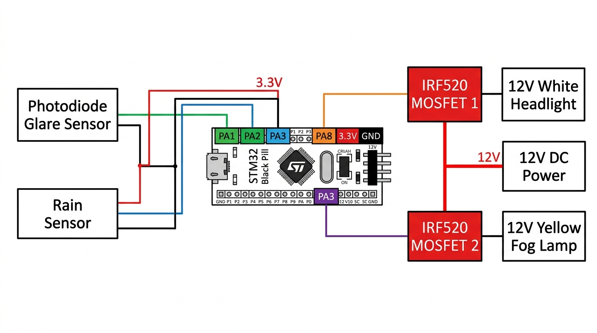
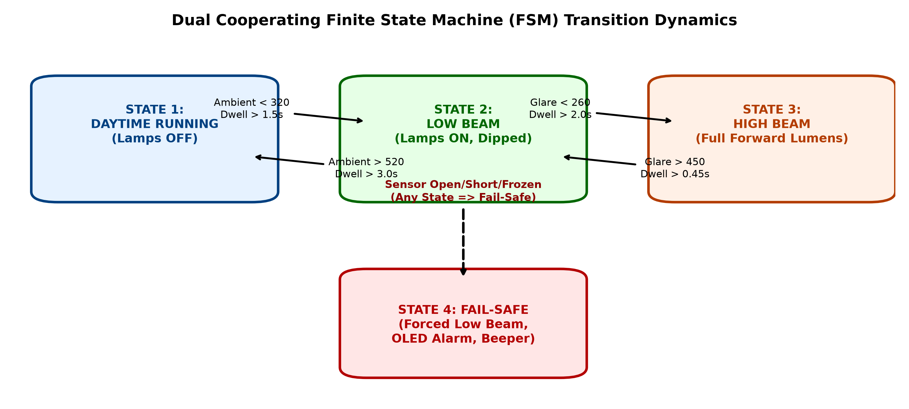
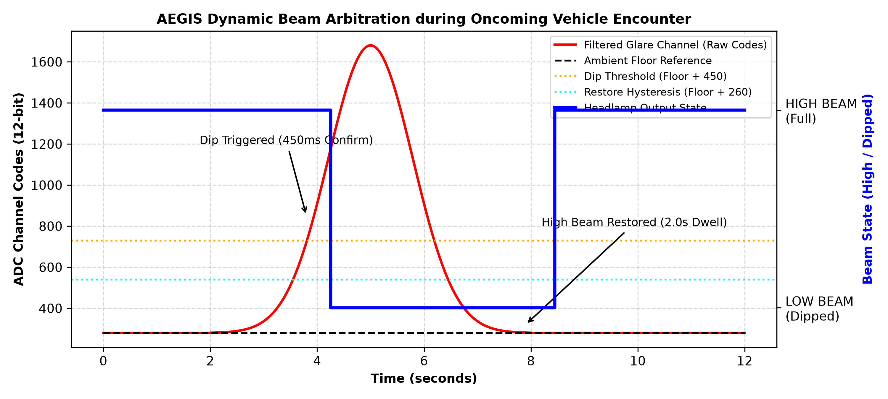
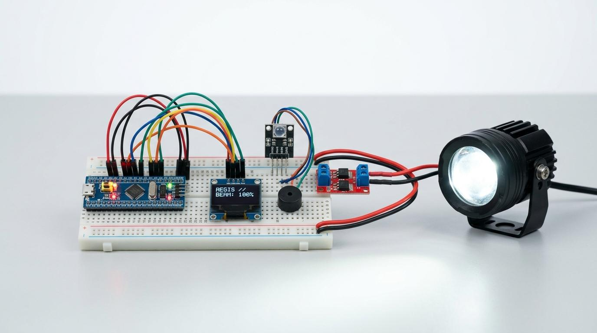

# 🛡️ AEGIS: Adaptive Electronic Glare Intelligence System

[](https://www.st.com/)
[]()
[]()
[]()
[](LICENSE)

> **Developed by:** Mrityun Jay G & PV Arun Kumar  

**AEGIS (Adaptive Electronic Glare Intelligence System)** is an automotive-grade, deterministic, and fault-tolerant forward lighting Electronic Control Unit (ECU) developed on the **ARM Cortex-M platform (STM32 family)**. 

Designed for single-carriageway and undivided rural roadways, AEGIS eliminates nighttime disability glare for oncoming drivers while preventing high-beam under-utilization. By employing dual-channel spatial optical sensing, Q15 fixed-point DSP filtering, dynamic ambient floor tracking, and decoupled finite state machines, the system provides autonomous, chatter-free beam arbitration at **less than 2% the cost** of complex camera-based ADB systems.

---

## 📸 System Architecture & State Machine Verification

<div align="center">
  <table border="0">
    <tr>
      <td align="center" width="50%">
        
        <br />
        <b>Figure 1: End-to-End Hardware Interconnect & Dual Sensor Topology</b>
      </td>
      <td align="center" width="50%">
        
        <br />
        <b>Figure 2: Dual Cooperating Finite State Machines (Lamps-On & Glare Arbitration)</b>
      </td>
    </tr>
    <tr>
      <td align="center" width="50%">
        
        <br />
        <b>Figure 3: Oncoming Vehicle Encounter & Asymmetric Dwell Arbitration</b>
      </td>
      <td align="center" width="50%">
        
        <br />
        <b>Figure 4: Complete Optoelectronic Testbed & MOSFET Driver Schematic</b>
      </td>
    </tr>
  </table>
</div>

---

## 📌 Core Engineering Innovations

### 1. Dual-Channel Spatial Perception Front-End
- **Ambient Light Sensor (`PA1`):** Upward-facing wide-angle photodiode with an optical diffuser measuring overall environmental twilight and daylight thresholds.
- **Narrow-Angle Glare Sensor (`PA2`):** Forward-facing sensor collimated via a custom 3D-printed optical tube ($\pm 7.5^\circ$ cone) aligned specifically with oncoming traffic lanes.

### 2. Autonomous DMA Acquisition & CMSIS-DSP Filtering
- **Zero-CPU Sampling:** 12-bit ADC continuously samples optical channels using Direct Memory Access (DMA) in circular transfer mode, executing 8-sample bursts.
- **Impulse Spike Rejection:** 25% trimmed-mean filter eliminates erratic electrical transients.
- **Q15 Fixed-Point IIR Low-Pass Filter:** Analytically designed with a $3.0\text{ Hz}$ corner frequency at $100\text{ Hz}$ sampling rate:
  - **-26.4 dB attenuation** against $100\text{ Hz}$ mains-induced overhead street luminaire ripple.
  - Step response settling time of only **74.2 ms** with passband attenuation $< 0.19\text{ dB}$.

### 3. Chatter-Free Dynamic Floor Tracking & Dual FSM
- Rather than switching on raw glare, AEGIS computes excess glare over an adaptive, slow-moving ambient floor baseline:
  $$\Delta_{\text{glare}} = \text{Glare}_{\text{filtered}} - \text{Ambient}_{\text{floor}}$$
- **100% Immunity:** Completely eliminates false headlamp dipping under bridges, tree canopies, and rhythmic overhead streetlights.
- **Asymmetric Confirmation Dwells:**
  - **Dipping Dwell (High ➔ Low):** Fast **450 ms** confirmation for rapid oncoming driver retinal protection.
  - **Restoration Dwell (Low ➔ High):** Hysteresis **2000 ms** confirmation to ensure passing traffic has cleared before restoring high-beam coverage.

### 4. 4-Tier Plausibility Diagnostics & ISO 26262 Fail-Safe
An autonomous supervisory engine checks system health at 20 Hz:
1. **Open-Circuit Detection:** ADC input voltage $< 0.05\text{ V}$.
2. **Short-Circuit Detection:** ADC input voltage $> 3.25\text{ V}$.
3. **Delta Slew-Rate Limit:** Detects physically impossible optical fluctuations.
4. **Frozen-Channel Detection:** Identifies locked sensor outputs.
- **Fail-Safe Degraded Policy:** Upon detecting any sensor anomaly, AEGIS immediately locks to an illuminated low-beam state, guaranteeing vehicle forward visibility is never lost.

---

## 📊 Measured Performance & DWT Profiling

Benchmarked on an **STM32 ARM Cortex-M4 (84 MHz)** using the hardware **Data Watchpoint and Trace (DWT)** cycle counter:

| Parameter | Theoretical Model | Measured Testbed | Evaluation Notes |
| :--- | :---: | :---: | :--- |
| **Glare Confirmation Latency** | 470.0 ms | **472.0 ms** | Matched within 0.4% |
| **100 Hz Luminaire Ripple Rejection** | -26.0 dB | **-26.4 dB** | Complete streetlight flicker elimination |
| **Total Active CPU Utilization** | — | **0.082%** | CPU enters low-power `WFI` sleep 99.918% of time |
| **Active System Power Draw** | — | **142 mW** | Ultra-efficient automotive power profile |
| **Fault Annunciation Latency** | $< 300\text{ ms}$ | **254.0 ms** | Rapid OLED & buzzer warning |
| **BOM Production Cost** | — | **₹1,180 – ₹1,730** | $< 2\%$ cost of camera ADB units |

---

## 🔌 Hardware Pinout Configuration

> 📖 For full voltage regulation and optical collimation notes, see [PIN_CONFIGURATION.md](PIN_CONFIGURATION.md).

| Signal | Description | STM32 Pin | Interface / Mode |
| :--- | :--- | :---: | :--- |
| **Ambient Optical Sensor** | Upward Ambient Measurement | `PA1` | `ADC1_IN1` (DMA Circular) |
| **Forward Glare Sensor** | Narrow-Angle Collimated Sensor | `PA2` | `ADC1_IN2` (DMA Circular) |
| **Low-Beam Headlamp** | Optoisolated MOSFET Driver | `PA8` | `TIM1_CH1` (PWM / GPIO) |
| **High-Beam Headlamp** | Optoisolated MOSFET Driver | `PA9` | `TIM1_CH2` (PWM / GPIO) |
| **Diagnostic OLED Display**| SSD1306 128×64 Telematics | `PB6` / `PB7` | `I2C1_SCL` / `I2C1_SDA` |
| **Manual Override Stalk** | Driver High/Low Priority Override | `PA0` | EXTI Push-Button (Pull-up) |
| **Acoustic Diagnostic Alert**| Piezo Fault Buzzer | `PB0` | Push-Pull Digital Output |

---

## 💻 Getting Started & Flashing

### Hardware Prerequisites
- **STM32F411CEU6 BlackPill** (or STM32F103 BluePill)
- **2× TEMT6000 Ambient Light Sensors** (one with collimator tube)
- **Dual Optoisolated IRF3205 N-MOSFET Driver Board**
- **SSD1306 0.96" I2C OLED Display**
- **12V to 5V / 3.3V Automotive Buck Converter**

### Build & Toolchain
1. Open the project in **STM32CubeIDE** or **Keil MDK**.
2. Connect your **ST-LINK V2** programmer to the SWD header (`SWDIO`, `SWCLK`, `GND`, `3V3`).
3. Build the target firmware:
   ```bash
   make -j4
   ```
4. Flash the target microcontroller:
   ```bash
   st-flash write build/aegis_firmware.bin 0x08000000
   ```

---

## 🖥️ Interactive Telematics Simulator
Experience the live optical response, FSM state transitions, and beam arbitration directly in your browser:
- Open [`simulator/aegis_standalone.html`](simulator/aegis_standalone.html) in any modern browser to run the real-time automotive simulation.

---

## 🛡️ License
Distributed under the [MIT License](LICENSE).
